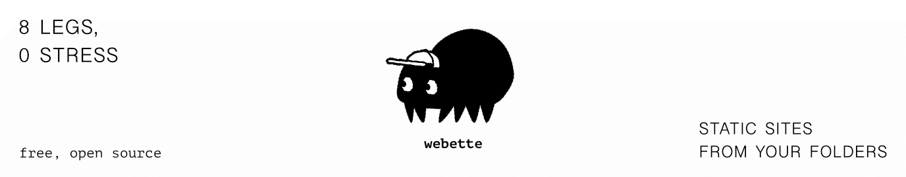

# webette

[](https://bsky.app/profile/artwo.xyz)



**Static sites from your folders. A tiny framework with big dreams.**

webette is a filesystem-first static site generator.
Place your content in folders, give it a few templates, and let it weave your site for you.

webette is designed to feel intuitive and lightweight, especially for small personal and creative websites.
But because it’s hackable, it can also scale into much more ambitious creations.

It is still **not ready for real deployment**, but it is already a living, evolving project with a clear direction.
This README explains what webette is today, what it wants to become, and why it exists.

---

## 🎯 Who is webette for?

webette is aimed at people who want a simple, transparent way to build and maintain a website without learning a complex toolchain. It is especially suitable for:

* people making personal sites,
* artists building lightweight portfolios,
* non-developers who prefer folders over frameworks,
* Neocities and Nekoweb-style projects,
* small archives and creative experiments.

If you can manage files and folders, you can manage a webette site.

And above all, webette exists to encourage more people to have their own personal space on the web — something simple and truly theirs.

---

## 🔮 The spirit of webette

webette is built on a simple idea:

> **Your folders already know what your website wants to be.**
> Let a tool respect that, not fight it.

Instead of inventing a new mental model, webette leans on the one you already use every day: the filesystem.

* Collections are folders.
* Entries are subfolders.
* Blocks are just files.
* Structure is something you see, not something you configure.

webette’s job is to observe, understand, and weave that structure into a coherent website.
It's a quiet, invisible helper doing sensible things.

---

## ✨ What webette aims to become

webette is early in its journey, but its goals are clear:

### **A static site generator shaped by your folders**

Not an abstract CMS, not an opaque pipeline: visible, intuitive structure.

### **A modular tool you can grow with**

webette will eventually support:

* plugins (new block types, processors, enrichers),
* transform pipelines you can enable or disable,
* custom behaviors on any folder or file type.

### **Starters you can trust**

Two families of starters:

* **Skelette starters**: minimal, no CSS, just enough to get going.
* **Full starters**: polished templates, layouts, structure, components.

### **Themes without ceremony**

A handful of Handlebars templates can define an entire site.
webette wants theme creation to feel like sketching: light, creative, playful.

### **A tool that stays out of the way**

webette doesn’t want to be “clever.”
It wants to be predictable, inspectable, and simple to debug.

---

## ⚠️ Current state

webette is under active development.
It can scan folders, generate routes, resolve content types, and render templates…
but **it is not ready for publishing real websites yet**.

Think of it as a working foundation with a lot still to build on top of it.

---

## ⚙️ What exists today

* Folder → collection / entry / block detection
* Slug generation, ordering via numeric prefixes
* Markdown rendering (unified / remark / rehype)
* Optional plain text mode for `.txt`
* Image support + metadata + variants (sharp if available)
* Audio support with metadata
* Video copying
* Template rendering via Handlebars
* A `serve` mode with rebuild + live watch
* A browsable internal model exported on build

---

## 📦 Installation (current workflow)

webette is not on npm yet.
To experiment:

```bash
git clone https://tangled.org/artwo.xyz/webette.git
cd webette
bun install
bun webette build
```

Later, webette will ship as a standalone bun binary.

---

## 🗂️ Project layout (how webette sees your folders)

```
my-site/
  posts/                 ← a collection
    01 my first post/    ← an entry
      01 index.md
      02 photo.jpg
    02 another post/
      1 index.md
  pages/                 ← another collection
    about/
      index.md
  _templates/            ← your templates
```

Then:

```bash
bun webette build
bun webette serve
```

Output appears in `_public/`.

---

## 📚 About the documentation

The [docs](https://tangled.org/artwo.xyz/webette/tree/main/docs) intentionally mix:

* what works today,
* what is being built,
* what webette intends to support later.

They currently act as both reference and roadmap.

---

## 🤝 Contributing

webette is not officially open to contributions yet — the foundations are still shifting.
You can follow development and discuss ideas on Bluesky.
PRs will open once the API stabilizes.

---

## 🕷️ bebette

bebette is the official spider mascot of webette.
Designed by me, **@artwo.xyz**, she wears a cap, has eight legs, and a strong opinion on folder hierarchies.

---

## 📜 License

webette is free and open source.
The LICENSE is intentionally simple for now. A more formal version will come later.

---

## 🤔 Why choose webette instead of another static site generator?

webette isn’t here to reinvent the wheel, and its author knows the existing SSG landscape well.
Tools like Hugo, Eleventy, or Astro are powerful and battle-tested.
webette simply aims at a different goal.

### **A filesystem-first approach you don’t have to learn**

Most SSGs build an internal model (routes, taxonomies, collections).
webette doesn’t. The directory tree *is* the structure.
If you can use folders, you can use webette.

### **Designed for people who want maintenance to be effortless**

Updating a webette site is deliberately simple: drop a file, edit a folder.
Once the initial setup is done, maintaining the site becomes nearly frictionless.

### **Friendly to non-developers and creative users**

webette doesn’t assume knowledge of pipelines, templating engines, or complex configs.
It’s suitable for personal sites, portfolios, small archives, Neocities/Nekoweb projects — places where the filesystem is already the most intuitive UI.

### **A focused tool for a specific niche**

webette isn’t trying to replace larger SSGs.
It exists for people who want a transparent, filesystem-driven way to create and maintain a simple personal space on the web.

### **Fun for tinkerers and wannabe hackers**

If you like making small tools, experimenting with templates, or building plugins, webette gives you a simple API to explore.
It’s a lightweight playground for people who enjoy customizing their tools without fighting them.

---

## 🌱 Final note

webette is still young, but it already has a personality.
It grows quietly, one thread at a time, toward a tool that feels light, intuitive, and joyful to use.

Thank you for being early. The web is better with curious people in it.